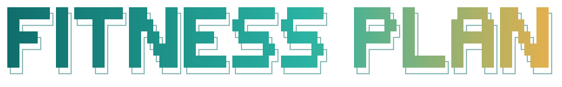
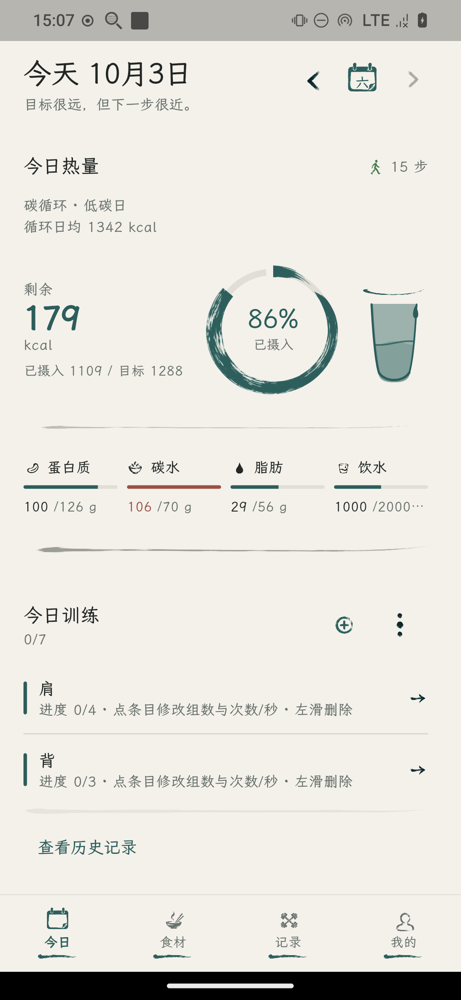
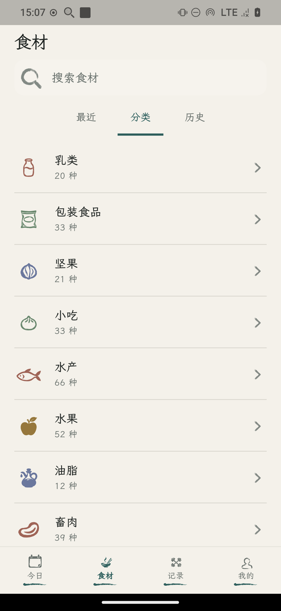
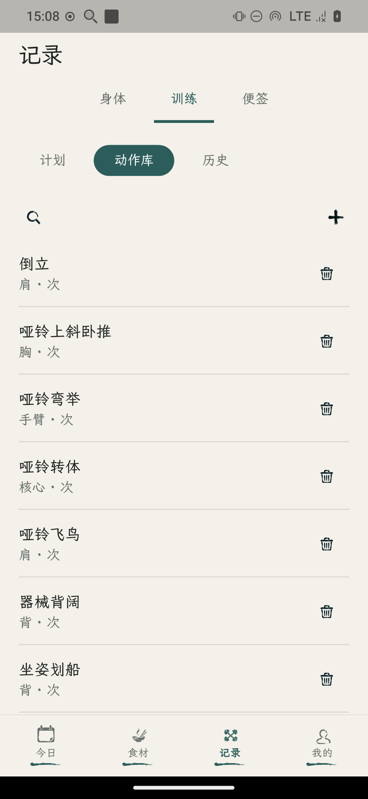
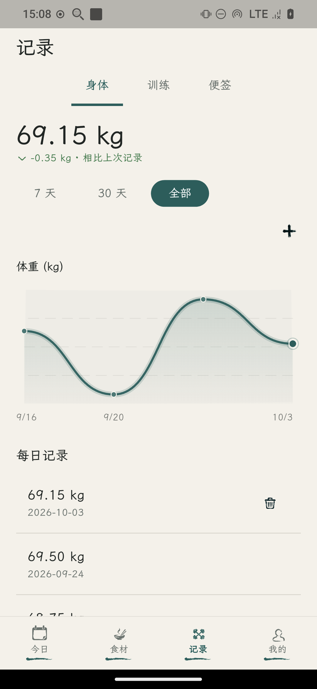
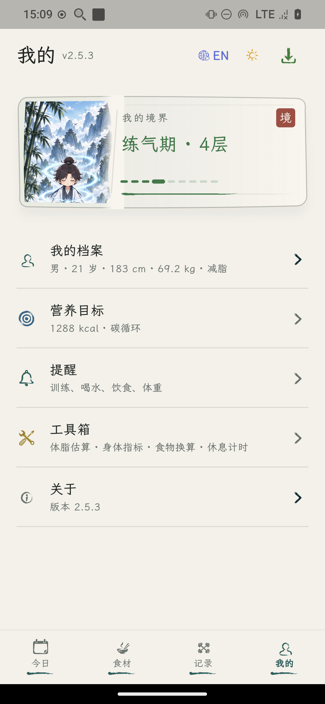
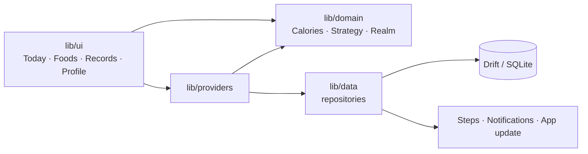

<div align="center">
<a id="top"></a>




<p>
  <strong>Your offline fitness & nutrition companion.</strong><br>
  Meals, training, and body data stay on this device. While you cut, a calorie deficit becomes a cultivation realm.
</p>

<p>
  <a href="https://github.com/Gryvaen/FitnessPlan/actions/workflows/ci.yml"></a>
  <a href="https://github.com/Gryvaen/FitnessPlan/releases"></a>
  
  
  <a href="LICENSE"></a>
</p>

<p>
  <a href="#features">Features</a> ·
  <a href="#cultivation">Cultivation</a> ·
  <a href="#download">Download</a> ·
  <a href="#build-from-source">Build from source</a> ·
  <a href="#development">Development</a>
  &nbsp;|&nbsp;
  <a href="./README.md">中文</a> · <b>English</b>
</p>

<table>
  <tr>
    <td align="center"><br><sub><b>Today</b></sub></td>
    <td align="center"><br><sub><b>Foods</b></sub></td>
    <td align="center"><br><sub><b>Train</b></sub></td>
    <td align="center"><br><sub><b>Progress</b></sub></td>
    <td align="center"><br><sub><b>Profile</b></sub></td>
  </tr>
</table>

</div>

## Why Fitness Plan

Your fitness log should stay on your own device.

It turns body stats into a daily calorie and macro budget, logs meals from a local food database, and keeps weight and training beside them. No account. No cloud.

## Features

<table>
  <tr>
    <td width="50%" valign="top">
      <h3>🍚 Eat</h3>
      Mifflin–St Jeor produces BMR, TDEE, and protein, carbs, and fat. The built-in library has 637 common Mainland China foods in 18 categories, with 10 nutrients per 100 g. Logging a meal spends today's budget. Water is recorded on the same day.
    </td>
    <td width="50%" valign="top">
      <h3>🏋️ Train</h3>
      An exercise library, training plans, and sets. What you do today stays on the device.
    </td>
  </tr>
  <tr>
    <td width="50%" valign="top">
      <h3>📈 Progress</h3>
      A weight chart, body-fat percentage, and a hint when recent weigh-ins barely move. Steps come from Health Connect or HealthKit. On Android, a missing permission falls back to the phone sensor.
    </td>
    <td width="50%" valign="top">
      <h3>☯️ Cultivate</h3>
      While cutting, the running calorie deficit becomes a realm, not only a shrinking number.
    </td>
  </tr>
</table>

## Cultivation

Cutting should not feel like a spreadsheet.

<div align="center">
<table>
  <tr>
    <td align="center"><br><b>Qi Refining</b></td>
    <td align="center">→</td>
    <td align="center"><br><b>Foundation</b></td>
    <td align="center">→</td>
    <td align="center"><br><b>Core Formation</b></td>
    <td align="center">→</td>
    <td align="center"><br><b>Nascent Soul</b></td>
    <td align="center">→</td>
    <td align="center"><br><b>Divine Transformation</b></td>
  </tr>
</table>

<b>7,700 kcal → 1 kg</b>
</div>

This path is complete only for the cut goal. Bulk and maintain can open the screen; the content is still a placeholder.

Calendar days can be marked as cheat days or rest days. New markers retain normal step and diet cultivation contributions; cheat-day deductions are optional and editable. Existing markers keep their previous cultivation behavior until edited. Each rest day can optionally delay carb cycling.

> [!NOTE]
> Balanced days, carb cycling, and carb tapering each set a target for the day. The numbers are self-service estimates for generally healthy adults, not a clinical prescription.

## Your data stays yours

<div align="center">
<table>
  <tr>
    <td align="center">🔐<br><b>No account</b></td>
    <td align="center">📴<br><b>No cloud</b></td>
    <td align="center">🚫<br><b>No tracking</b></td>
    <td align="center">💾<br><b>Drift → SQLite</b></td>
  </tr>
</table>
</div>

Meals, weight, workouts, and preferences stay on the device. You can export a backup and import it again. Workout, water, meal, and weigh-in reminders are each their own. The interface is Chinese and English, in a light theme and a graphite theme.

## Download

Download an APK from [GitHub Releases](https://github.com/Gryvaen/FitnessPlan/releases) or [Gitee Releases](https://gitee.com/Gryvaen/FitnessPlan/releases). Try Gitee when GitHub is unreachable. Most phones want `FitnessPlan-*-android-arm64-v8a.apk`.

Users on older versions may need to install the first dual-source version manually. The update dialog remembers Automatic / Gitee / GitHub preference. Manual choices remain eligible for fallback.

Android DownloadManager continues downloads while the app is closed; fallback runs when the app is active again. Both foreground installation and background install notifications require matching file size and SHA-256. Checksums establish file consistency; Android still verifies APK signatures.

## Build from source

You need [Flutter](https://docs.flutter.dev/get-started/install) matching the Dart SDK constraint `^3.12.2` in `pubspec.yaml`.

```bash
git clone https://github.com/Gryvaen/FitnessPlan.git
cd FitnessPlan
flutter pub get
flutter run
```

On first launch, enter sex, age, height, weight, activity, and a goal: cut, maintain, or bulk.

## Architecture

Calorie math, fat-loss strategies, plateau detection, and cultivation progress live in `lib/domain/`, with no Flutter imports. Screens talk to repositories through Riverpod. Repositories write to the database or to system services.



Android silently checks GitHub Releases on launch and when the app returns to the foreground. Desktop and web have no health store, so step sync is marked unsupported.

## Tech stack

| Component | Version | Purpose |
| --- | --- | --- |
| Flutter / Dart | `^3.12.2` | Cross-platform UI; body text uses LXGW WenKai and Noto Sans SC |
| flutter_riverpod | `^3.3.2` | State management |
| go_router | `^17.3.0` | Routing |
| drift | `^2.34.2` | On-device SQLite |
| health | `^13.3.1` | Steps |
| flutter_local_notifications | `^22.0.1` | Local reminders |
| fl_chart | `^1.2.0` | Weight charts |

The bottom navigation and most screens use the ink icons in `assets/ink/`.

## Project structure

```text
FitnessPlan/
├── lib/
│   ├── domain/          # calories, strategy, cultivation
│   ├── data/            # Drift, repositories, steps, reminders
│   ├── providers/
│   ├── ui/              # today, foods, records, profile
│   └── l10n/
├── assets/
│   ├── food_seed.json   # 637 foods
│   ├── branding/
│   ├── cultivation/     # realm art
│   └── ink/
├── test/
├── tool/                # release scripts
└── android/ ios/ linux/ macos/ windows/ web/
```

## Development

After changing a table:

```bash
dart run build_runner build
```

After editing [lib/l10n/app_zh.arb](lib/l10n/app_zh.arb) or the template [lib/l10n/app_en.arb](lib/l10n/app_en.arb), run `flutter gen-l10n`. `flutter pub get` generates as well.

After editing [assets/food_seed.json](assets/food_seed.json), bump `kFoodSeedVersion` (currently `13`) in [lib/data/repositories/food_repository.dart](lib/data/repositories/food_repository.dart) so existing installs re-sync.

Before a pull request:

```bash
flutter analyze --no-fatal-infos
flutter test
```

### Build

A signed Android release (do not commit `key.properties` or `*.jks`):

```bash
./tool/release/build_release_apk.sh
```

See [android/key.properties.example](android/key.properties.example). iOS needs macOS and Xcode:

```bash
flutter build ipa --release
```

Releases here are Android APKs only. Linux emulator notes are in [docs/android-emulator.md](docs/android-emulator.md) (Chinese).

### Release (maintainers)

<details>
<summary>Dual-source publishing to GitHub and Gitee</summary>

<br>

Build once with `./tool/release/build_release_apk.sh`. Configure `GITHUB_TOKEN` and `GITEE_TOKEN` in your local environment (never commit them), then run:

```bash
python3 tool/release/publish_release.py --tag vX.Y.Z --notes-file /path/to/release-notes.md
```

The build generates four APKs, `SHA256SUMS`, and `update-manifest.json`. The publisher uploads identical files to both platforms, manifest last, and verifies public downloads. Retry the same command after partial failure: identical files are skipped; conflicting files are never overwritten. Every release from 2.6.1 on must carry the manifest; releases up to 2.6.0 have none and are taken from GitHub only, verified against the asset size and SHA-256 that GitHub reports.

Defaults: GitHub `Gryvaen/FitnessPlan` (main), Gitee `Gryvaen/FitnessPlan` (master). Override with `--github-repo`, `--gitee-repo`, `--github-target`, `--gitee-target`. Verify destinations before publishing; source synchronization is not performed and target commits must already exist.

</details>

## Roadmap

- [x] Cut cultivation: Qi Refining → Foundation → Core Formation → Nascent Soul → Divine Transformation
- [x] Local meals, training, body logs, and Android releases
- [ ] Bulk and maintain cultivation (the entrance exists; the page is still a placeholder)

## Contributing

Match CI: `flutter analyze --no-fatal-infos` and `flutter test`. The workflow is [`.github/workflows/ci.yml`](.github/workflows/ci.yml). Style is in [analysis_options.yaml](analysis_options.yaml).

## Donate

If this project helps, you can [donate via Alipay](docs/donate.md).

## License

Free for personal, educational, and other non-commercial use. Commercial use needs a separate license; contact via GitHub Issues. See [LICENSE](LICENSE).

<div align="center">
<br>
<sub>Made with Flutter · <a href="#top">Back to top ↑</a></sub>
</div>
