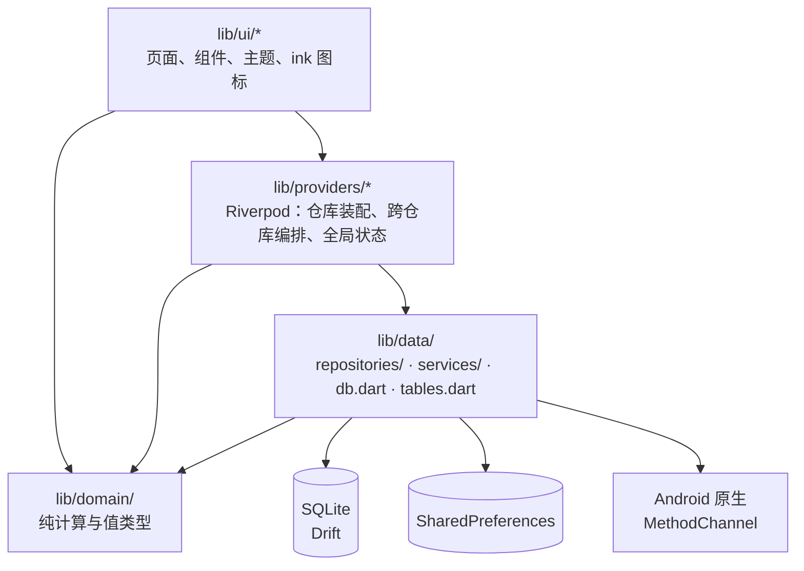

# 架构总览

这份文档讲代码怎么分层、应用怎么启动、路由和状态怎么组织，以及主题和多语言的约定。第一天看。具体到每个文件的说明见 [code-map.md](code-map.md)，业务规则见 [features.md](features.md)。

## 技术栈

- **UI**：Flutter（Material 3）
- **状态**：flutter_riverpod 3
- **路由**：go_router 17（`StatefulShellRoute` 实现四个标签页）
- **数据库**：Drift 2（SQLite，单文件 `fitness_plan.sqlite`）
- **键值存储**：shared_preferences
- **通知**：flutter_local_notifications（iOS/macOS 路径），Android 上则由自写的 Kotlin 原生代码负责
- **步数**：health 插件（Health Connect / HealthKit）+ Android 原生计步传感器
- **图表**：fl_chart

应用完全离线运行，只有检查更新时会联网。

## 分层

| 层 | 职责 | 可以依赖 |
|---|---|---|
| `lib/domain/` | 纯 Dart 的计算和值类型：热量、饮食策略、碳循环、修仙、平台期、日期标记 | 只依赖 domain 内部。`goal_quotes.dart` 为了 `Locale` 引了 `flutter/widgets.dart`，是唯一的例外 |
| `lib/data/` | 持久化：Drift 数据库、SharedPreferences、HTTP、平台通道 | domain |
| `lib/providers/` | 把仓库装配成 provider，编排跨仓库的操作（如切换目标时同时处理策略和修仙账本），持有全局状态 | data、domain、l10n |
| `lib/ui/` | 页面、弹窗、组件 | 一般通过 providers 访问数据；可以直接用 domain 的计算函数和 `db.dart` 里的行类型 |
| `lib/l10n/` | 生成的多语言代码，以及手写的 `app_localizations_ext.dart` | — |

现有代码里有几处违反分层的引用，记录在 [known-issues.md](known-issues.md)。新代码不要再增加这类引用。

`lib/features/loading/` 是一套旧的启动动画（剑客），应用里已经不再使用，只有 `test/swordsman_loading_test.dart` 还在引用。当前的启动页是 `lib/ui/loading/discipline_freedom_loading_page.dart`。

### 数据放在哪里

- **SQLite**：所有日志和计划，包括饮食、体重、饮水、步数、训练、笔记、饮食策略版本、每日目标快照、日期标记、食材库。
- **SharedPreferences**：用户档案（`user_profile`，JSON）、修仙账本（`cut_cultivation_state`）、提醒设置、主题、语言、表单记忆、计算器历史、饮水目标、更新状态。

备份会把这两部分都打包进去，见 [features.md](features.md#备份与导入)。

## 启动流程

`lib/main.dart`：

1. `deferFirstFrame()`：在第一帧画好之前一直保留原生启动画面。
2. 读取 `SharedPreferences`；初始化通知（`ReminderNotifications.ensureInitialized()`，它同时初始化休息计时器的通知）。
3. `runApp(ProviderScope(overrides: [sharedPreferencesProvider...]))`。注意 `sharedPreferencesProvider` 必须在这里覆盖，否则会直接抛异常。
4. `_Bootstrap` 把启动动画 `DisciplineFreedomLoadingPage` 盖在 `FitnessApp` 上面：
   - 动画期间就开始同步食材种子（`foodsSeedProvider`），不等待它完成。种子同步可能比 1.4 秒的入场动画更久，食材页面会自己等待同一个 future。
   - `FitnessApp` 在动画下面预先构建，动画结束后再移除遮罩。Stack 的子节点结构保持不变，这样预构建的元素不会被丢弃。
5. 加上 `--dart-define=LOADING_LAB=true` 时，会改为进入启动动画调试页 `LoadingLabPage`。

`lib/app.dart` 的 `FitnessApp`：
- 第一帧之后，重新同步一次提醒排期（`remindersProvider.notifier.syncSchedule()`），并读取 `stepServiceProvider`（首次运行时会自动打开后台计步）。
- `MaterialApp.router` 的主题来自 `themeProvider`，语言来自 `localeProvider`（为 null 时跟随系统，找不到匹配的语言时回退到英文）。
- 全局有一个点空白处收起键盘的 `GestureDetector`。

## 路由

定义在 `lib/app.dart` 的 `routerProvider`。

- 初始位置：`/today`。
- 重定向：没有档案时去 `/onboarding`；已有档案却访问 `/onboarding` 时去 `/today`；旧路径 `/weight` 重定向到 `/records`。
- **`refreshListenable` 只在档案从无到有、或从有到无的那一刻触发。** 不要改成每次编辑档案都刷新：那样会和正在进行的页面返回动作产生竞争（例如 `ProfileEditPage` 保存后返回时）。

标签页（`StatefulShellRoute`，壳是 `lib/ui/shell/main_shell.dart`，左右滑动切换）：

| 标签 | 路径 | 子路由 |
|---|---|---|
| 今日 | `/today` | — |
| 食材 | `/foods`（`?tab=history`） | `favorites`、`presets`、`category?name=`、`custom?id=...`、`:id` |
| 记录 | `/records?tab=body\|train\|notes&sub=...` | `notes/edit?date=` |
| 我的 | `/profile` | `edit`、`cultivation/...`、`reminders`、`nutrition/...`、`tools/...` |

根级路由（不属于任何标签页）：`/onboarding`、`/log-meal`、`/meal-preset/:id`、`/meal-preset/:id/add`、`/day-meals?date=`（以底部弹层的形式呈现）、`/meal/:id`，以及 `/custom-food`、`/food-detail/:id`。

最后两个是 `/foods` 下对应页面的「根级副本」。从根级路由跳转时，如果推入标签页内的路由，会触发 Navigator 的重复页面 key 断言。所以从根级页面打开食材详情时，要用 `lib/ui/widgets/food_name_link.dart` 里的 `foodDetailLocation()` 生成路径。

`MainShell` 在启动和每次回到前台时会重新同步步数，并静默检查一次更新（仅 Android）。

## 状态管理（Riverpod）

- `lib/providers/app_providers.dart` 是汇总导出文件，UI 代码统一 import 它。
- `core_providers.dart`：`sharedPreferencesProvider`、`databaseProvider`，以及每个仓库对应的 provider。所有仓库 provider 都 `ref.watch(databaseProvider)`，所以 invalidate 数据库会让它们全部重建。导入备份就是靠这个机制刷新的。
- 各业务的 provider 文件按领域划分：`profile_providers`、`diet_strategy_providers`、`cultivation_providers`、`meal_providers`、`step_providers` 等，逐个说明见 [code-map.md](code-map.md#libproviders)。
- **命名陷阱**：`todayMealsProvider` 和 `todayIntakeProvider` 跟随的是 `selectedDayProvider`（今日页上可以左右切换日期），并不总是「今天」。
- 测试里覆盖 provider 的方法见 [testing.md](testing.md)。

## 主题

定义在 `lib/ui/theme/app_theme.dart`。

- 目前只有两套主题：`AppThemeId.fresh`（浅色）和 `AppThemeId.graphite`（深色），在「我的」页顶部切换。旧版的主题 id（`day`、`forest`、`warm`、`sunrise`、`night`、`midnight`、`aurora`）通过 `AppThemeId.legacyMap` 映射到这两套上。代码里还残留着「四个主题」的旧注释，以这里为准。
- **页面不要硬编码颜色。** 通用颜色从 `Theme.of(context).colorScheme` 取；随主题变化的视觉 token 从 `AppThemeVisuals.of(context)` 取；固定的语义色（蛋白质、碳水、脂肪、饮水、成功、警告）用 `AppColors`。
- 间距统一使用 `AppSpacing`（`listPage`/`formPage` 20、`card` 16、`section` 24、`field` 12、`compact` 8），圆角用 `AppRadius`，最小点击区域为 `kMinTapTarget`（44）。
- 字体：`LXGWWenKai`（霞鹜文楷），另外打包了 `NotoSansSC` 备用。
- 通用的页面外框和组件在 `lib/ui/theme/sport_chrome.dart`：`PageTitle`、`SportTabs`、`SportEmptyState`、`AppChromeScaffold` 等。

### ink 图标

界面图标统一使用水墨风的位图图标，不使用 Material 的 `Icons.*`，有测试专门检查这一点（`test/*_ink_icon_audit_test.dart`）。

- `lib/ui/ink/ink_icon.dart`：`InkGlyph` 枚举加上 `InkIcon` 组件，渲染 `assets/ink/icons/{light,dark}/<名称>-v1.png`。深色主题下把图标当作透明度遮罩重新着色。
- 新增图标的步骤：把浅色和深色两张 PNG 放进 `assets/ink/icons/light/` 和 `dark/`（256px），在 `InkGlyph` 里加一项，然后跑 `test/ink_icon_assets_test.dart`。
- Android 原生的闹钟锁屏页（`ReminderAlarmActivity`）直接读取其中几张图标和字体文件。重命名这些资源会让原生页面悄悄回退到默认样式，见 [android-native.md](android-native.md)。

## 多语言

支持简体中文和英文。

- 配置：`l10n.yaml`（模板是 `lib/l10n/app_en.arb`），`pubspec.yaml` 里设了 `generate: true`。
- 在代码里通过 `context.l10n.xxx` 取文案，`context.l10n` 由 `lib/l10n/app_localizations_ext.dart` 提供。
- **新增文案的步骤**：
  1. 在 `app_en.arb` 里加 key（带占位符的要写 `@key` 元数据）；
  2. 在 `app_zh.arb` 里加同一个 key；
  3. 运行 `flutter gen-l10n`，把生成的 `app_localizations*.dart` 一起提交。
- 例外：`lib/ui/tools/reminder_status_labels.dart` 是一个扩展，用 `localeName.startsWith('zh')` 直接返回中文或英文字符串。这是历史写法，新文案不要再这么加。
- 枚举到文案的映射写在各功能的 labels 文件里（如 `ui/strategy/strategy_labels.dart`、`ui/profile/cultivation_labels.dart`），它们引用的仍然是 ARB 的 key，这种写法没有问题。
- 仓库里还有一些没有本地化的中文：仓库层抛出的错误信息、更新下载的进度文字等，见 [known-issues.md](known-issues.md)。
- 食材名称：数据库里存中文名，英文界面下显示 `nameEn`（见 `FoodItemL10n.displayName`）；食材分类用中文作为 key，由 `FoodCategoryL10n` 翻译。

## 平台

- **Android**：主力平台，发布的就是 Android APK。提醒、休息计时器、后台计步、更新下载都有大量原生代码，见 [android-native.md](android-native.md)。
- **iOS**：可以构建（需要 macOS + Xcode），已配置 HealthKit 读取步数；提醒和计时器走 flutter_local_notifications，没有原生响铃服务。不发布。
- **macOS / Linux / Windows / Web**：只有 Flutter 模板，步数同步显示「不支持」。
